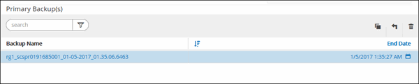

= Restore and recover an auto-discovered database backup with SnapCenter
:icons: font
:imagesdir: ../media/

[.lead]
You can use SnapCenter to restore and recover data from one or more backups.

.Before you begin

* No application should be connected to the database. SnapCenter checks for connections and fails the restore operation if any exist.
* You must have backed up the resource or resource groups.
* You must have canceled any backup operation that is currently in progress for the resource or resource group that you want to restore.
* No application should be connected to the database. SnapCenter checks for connections and fails the restore if any exist.
* For pre restore, post restore, mount, and unmount commands, you should check if the commands exist in the command list available on the plug-in host from the following paths:
** Default location on the Windows host: `C:\Program Files\NetApp\SnapCenter\Snapcenter Plug-in Creator\etc\allowed_commands.config`
** Default location on the Linux host: `/opt/NetApp/snapcenter/scc/etc/allowed_commands.config`

NOTE: If the commands do not exist in the command list, then the operation will fail.

.About this task

When you select Complete Resource, SnapCenter restores the database by using Single File SnapRestore (SFSR). It does not revert the volume, and volume revert is not offered for auto-discovered Db2 resources. The table describes what is restored for each storage type.

Data files are the files under the database storage paths, the tablespace containers, the local database directory, and the database path. The active log path, the instance home directory, and the archive log paths are excluded.

SnapCenter does not run the Db2 `ROLLFORWARD` command after a restore, and auto-recovery is not supported. For databases with archive logging, run `ROLLFORWARD` manually after the restore completes.
When you restore from a secondary (mirrored or vaulted) backup, SnapCenter uses a SnapMirror restore of the same files (NAS) or LUNs (SAN).

The following table describes how SnapCenter performs a complete resource restore of an auto-discovered resource, based on the storage type.

[options="header"]
|===
| Storage | Complete resource restore
a| NAS a| SFSR of the recorded Db2 data files only. Volume revert is not used. The Db2 online (active) logs and archived logs are not restored, so transactions written after the backup remain available to roll forward.
a| SAN a| SFSR of whole LUNs - every LUN behind a file system that contains data files. Anything else on those LUNs is restored too, including log files that share a LUN with data. A file system that holds only log or archive files is not restored.
|===

For ONTAP 9.12.1 and earlier versions, the clones that are created from SnapLock Vault snapshots as part of a restore inherit the SnapLock Vault expiry time. After the SnapLock expiry time passes, the storage administrator must manually clean up the clones.

NOTE: Manually added resources, except for Azure NetApp Files resources, also offer file-level restore. In file-level restore, you select the paths or LUNs to restore.

.Steps

. In the left navigation pane, select *Resources*, and then select the appropriate plug-in from the list.
. In the Resources page, filter resources from the *View* drop-down list based on resource type.
+
The resources are displayed along with type, host, associated resource groups and policies, and status.
+
NOTE: Although a backup might be for a resource group, when you restore, you must select the individual resources you want to restore.
+
If the resource is not protected, `Not protected` is displayed in the Overall Status column. This can mean either that the resource is not protected, or that the resource was backed up by a different user.

. Select the resource, or select a resource group and then select a resource in that group.
+
The resource topology page is displayed.

. From the Manage Copies view, select *Backups* either from the primary or secondary (mirrored or vaulted) storage systems.
. In the Primary backup(s) table, select the backup that you want to restore from, and then click **.
+

. In the Restore Scope page, select *Complete Resource* to restore the recorded data files (NAS) or the LUNs (SAN) of the Db2 database.

. In the Pre ops page, enter pre restore commands to run before the restore job. The unmount command field is not displayed for auto-discovered resources. This step is optional.

. In the Post ops page, enter post restore commands to run after the restore job. The mount command field is not displayed for auto-discovered resources. This step is optional.

. In the Notification page, from the *Email preference* drop-down list, select the scenarios in which you want to send the emails.
+
You must also specify the sender and receiver email addresses and the subject of the email. SMTP must also be configured on the *Settings* > *Global Settings* page.

. Review the summary, and then select *Finish*.
. Monitor the operation progress by selecting *Monitor* > *Jobs*.

.After you finish
* Archive logging: SnapCenter initializes the database as `MIRROR`, and it stays in the `DB pending` state. SnapCenter checks the rollforward status after initializing. If the status is neither `DB pending` nor `not pending`, the restore job fails. Run ``ROLLFORWARD DATABASE <name> TO END OF LOGS AND STOP`` or to a point in time, manually. On NAS, the logs are not overwritten, so you can roll forward to the end of logs.

* Circular logging: SnapCenter initializes the database as `SNAPSHOT` and no roll forward is needed.

// SNAPCDOC-419, 2026-NOV-25