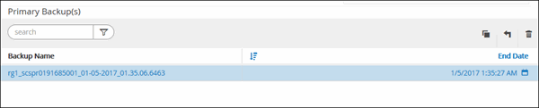

= Restore a manually added resource backup with SnapCenter
:icons: font
:imagesdir: ../media/

[.lead]
You can use SnapCenter to restore and recover data from one or more backups.

.Before you begin

* You must have backed up the resource or resource groups.
* You must have canceled any backup operation that is currently in progress for the resource or resource group that you want to restore.
* For pre restore, post restore, mount, and unmount commands, you should check if the commands exist in the command list available on the plug-in host from the following paths:
** Default location on the Windows host: `C:\Program Files\NetApp\SnapCenter\Snapcenter Plug-in Creator\etc\allowed_commands.config`
** Default location on the Linux host: `/opt/NetApp/snapcenter/scc/etc/allowed_commands.config`

NOTE: If the commands do not exist in the command list, then the operation will fail.

.About this task

* For ONTAP 9.12.1 and earlier versions, the clones that are created from SnapLock Vault snapshots as part of a restore inherit the SnapLock Vault expiry time. After the SnapLock expiry time passes, the storage administrator must manually clean up the clones.

The following table describes how SnapCenter performs a complete resource restore of a manually added resource, based on the storage type.

[options="header"]
|===
| Storage | Complete resource restore
a| NAS a| Volume revert (volume SnapRestore), because SnapCenter does not know the files on the volume.
a| SAN a| SFSR of whole LUNs, as for auto-discovered SAN.
|===

[role="tabbed-block"]
====

.SnapCenter UI
--
.Steps

. In the left navigation pane, click *Resources*, and then select the appropriate plug-in from the list.
. In the Resources page, filter resources from the *View* drop-down list based on resource type.
+
The resources are displayed along with type, host, associated resource groups and policies, and status.
+
NOTE: Although a backup might be for a resource group, when you restore, you must select the individual resources you want to restore.
+
If the resource is not protected, "`Not protected`" is displayed in the Overall Status column. This can mean either that the resource is not protected, or that the resource was backed up by a different user.

. Select the resource, or select a resource group and then select a resource in that group.
+
The resource topology page is displayed.

. From the Manage Copies view, select *Backups* either from the primary or secondary (mirrored or vaulted) storage systems.
. In the Primary backup(s) table, select the backup that you want to restore from, and then click **.
+

. In the Restore Scope page, select *Complete Resource*.
 .. If you select *Complete Resource*, all of the configured data volumes of the IBM Db2 database are restored.
+
If the resource contains volumes or qtrees, the snapshots taken after the snapshot selected for restore on such volumes or qtrees are deleted and cannot be recovered. Also, if any other resource is hosted on same volumes or qtrees, then that resource is also deleted.
+
You can select multiple LUNs.

+
NOTE: If you select *All*, all the files on the volumes, qtrees, or LUNs are restored.

. In the Pre ops page, enter pre restore and unmount commands to run before performing a restore job.

. In the Post ops page, enter mount and post restore commands to run after performing a restore job.

. In the Notification page, from the *Email preference* drop-down list, select the scenarios in which you want to send the emails.
+
You must also specify the sender and receiver email addresses and the subject of the email. SMTP must also be configured on the *Settings* > *Global Settings* page.

. Review the summary, and then click *Finish*.
. Monitor the operation progress by clicking *Monitor* > *Jobs*.

.After you finish
Recovery is possible only if the `ROLLFORWARD DATABASE ... QUERY STATUS` output shows the rollforward status as `DB pending`. This status applies to Db2 databases with archive logging enabled.
--
.PowerShell cmdlets
--
.Steps

. Initiate a connection session with the SnapCenter Server for a specified user by using the Open-SmConnection cmdlet.
+
----
PS C:\> Open-SmConnection  
----
. Identify the backup that you want to restore by using the Get-SmBackup and Get-SmBackupReport cmdlets.
+
This example shows that there are two backups available for the restore:
+
----
 PS C:\> Get-SmBackup -AppObjectId cn24.sccore.test.com\DB2\db2inst1\Library

        BackupId    BackupName                    BackupTime            BackupType
        --------    ----------                    ----------            ----------
         1          Payroll Dataset_vise-f6_08... 8/4/2015 11:02:32 AM  Full Backup
         2          Payroll Dataset_vise-f6_08... 8/4/2015 11:23:17 AM
----
+
This example displays detailed information about the backup from January 29th 2015 to February 3rd, 2015:
+
----
PS C:\> Get-SmBackupReport -FromDateTime "1/29/2015" -ToDateTime "2/3/2015"

SmBackupId           : 113
   SmJobId              : 2032
   StartDateTime        : 2/2/2015 6:57:03 AM
   EndDateTime          : 2/2/2015 6:57:11 AM
   Duration             : 00:00:07.3060000
   CreatedDateTime      : 2/2/2015 6:57:23 AM
   Status               : Completed
   ProtectionGroupName  : Clone
   SmProtectionGroupId  : 34
   PolicyName           : Vault
   SmPolicyId           : 18
   BackupName           : Clone_SCSPR0019366001_02-02-2015_06.57.08
   VerificationStatus   : NotVerified

   SmBackupId           : 114
   SmJobId              : 2183
   StartDateTime        : 2/2/2015 1:02:41 PM
   EndDateTime          : 2/2/2015 1:02:38 PM
   Duration             : -00:00:03.2300000
   CreatedDateTime      : 2/2/2015 1:02:53 PM
   Status               : Completed
   ProtectionGroupName  : Clone
   SmProtectionGroupId  : 34
   PolicyName           : Vault
   SmPolicyId           : 18
   BackupName           : Clone_SCSPR0019366001_02-02-2015_13.02.45
   VerificationStatus   : NotVerified
----

. Restore data from the backup by using the Restore-SmBackup cmdlet.
+
NOTE: AppObjectId is "Host\Plugin\UID", where UID = <instance_name> is for manually discovered DB2 instance resource and UID = <instance_name>\<databse_name> is for IBM Db2 database resource. You can get the ResourceID from the Get-smResources cmdlet.

+
----
Get-smResources  -HostName cn24.sccore.test.com  -PluginCode DB2
----
+
This example shows how to restore the database from the primary storage:
+
----
Restore-SmBackup -PluginCode DB2 -AppObjectId cn24.sccore.test.com\DB2\db2inst1\DB01 -BackupId 3
----
+
This example shows how to restore the database from the secondary storage:
+
----
Restore-SmBackup -PluginCode 'DB2' -AppObjectId cn24.sccore.test.com\DB2\db2inst1\DB01 -BackupId 399 -Confirm:$false  -Archive @( @{"Primary"="<Primary Vserver>:<PrimaryVolume>";"Secondary"="<Secondary Vserver>:<SecondaryVolume>"})
----
+
The information regarding the parameters that can be used with the cmdlet and their descriptions can be obtained by running _Get-Help command_name_. Alternatively, you can also refer to the https://docs.netapp.com/us-en/snapcenter-cmdlets/index.html[SnapCenter Software Cmdlet Reference Guide^].
--
====

// SNAPCDOC-419, 2026-NOV-25